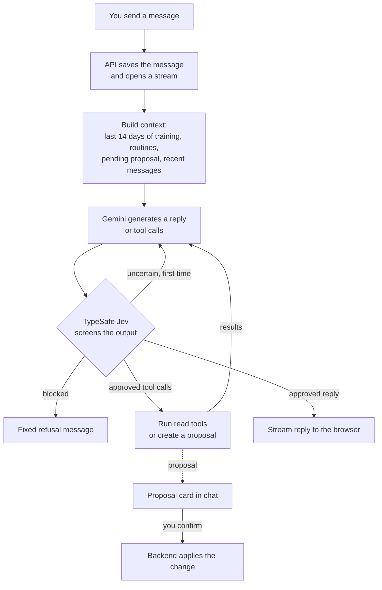
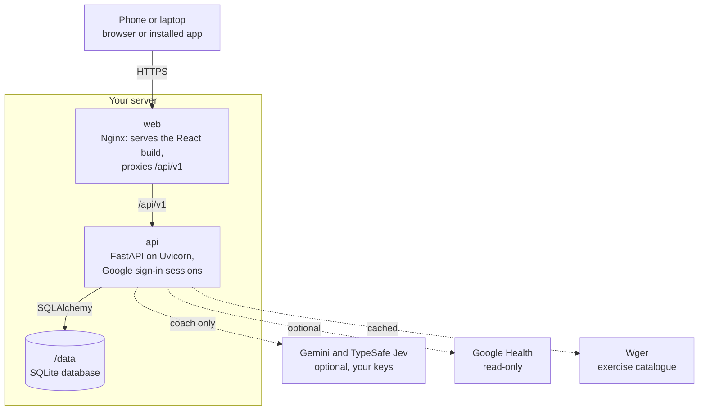

# Jern

Jern is a self-hosted strength training tracker. Plan routines on a calendar,
log sets from your phone, watch your progress, and ask an AI coach to review or
rewrite your plan. Jern runs as a React app that you can install from the
browser on your phone, backed by a FastAPI and SQLite server.

For the API, database, and backend build, see the [Backend README](backend/README.md).

## Features

| Area | What it does |
| --- | --- |
| **Dashboard** | Greets you with this week's training summary, current bodyweight, and last workout. A front and back body map shows each muscle's volume, set count, or an activity heatmap for any week. Lists completed and upcoming workouts for the selected week. |
| **Workout tracking** | Logs one exercise at a time with weight, reps, and RPE, plus warm-up sets, supersets, exercise swaps, notes, and a rest timer. Shows last time's sets, best weight, and estimated one-rep max (1RM) for each exercise. Saves as you go, so you can pause and resume a workout. |
| **Routines** | Reusable workout templates grouped in folders. Each exercise has a set count, rep range, optional target weight, and rest time. Share a routine or a whole folder as a link, and import one from a link. |
| **Calendar** | Month view that combines planned and logged workouts. Set a repeating weekly plan, move or remove a single day, and label days. |
| **History** | Every completed session, plus per-exercise volume charts over 1 month, 3 months, 6 months, 1 year, or all time. |
| **Bodyweight** | Log weigh-ins and follow the trend on a chart from the dashboard. |
| **Coach** | Chat with an AI coach that reads your training data. It answers training, recovery, and nutrition questions. You approve any change it suggests to routines or the weekly plan before it is applied. See [The coach's AI pipeline](#the-coachs-ai-pipeline). |
| **Health** | Optional read-only Google Health connection for steps, active minutes, sleep stages, heart rate variability (HRV), and resting heart rate. Includes 7-day trends and an editable step goal. [Google Health setup](docs/google-health.md) |
| **Settings** | Colour theme, coach response length, and sign out. |
| **Demo** | Optional public, read-only view of one account's training. Disabled by default. |

Exercise search uses the open [Wger](https://wger.de/) catalogue, which is cached
on the server so search still works when Wger is offline. Sign-in uses Google
accounts on an allowlist you set.

## Training

### How a training week works

1. **Build routines.** Create a routine such as *Push A* and add exercises from
   the catalogue. Give each exercise a set count, rep range (for example 8 to
   12), rest time, and optionally a target weight. Group routines into a
   folder for each program.
2. **Schedule them.** In the calendar, assign routines to weekdays as a weekly
   plan. Move or skip a single day without changing the rest of the plan.
3. **Start the workout.** Starting today's workout copies the routine's
   exercises and sets into a new session. The routine itself does not change,
   so edits during a workout affect only that session.
4. **Log each set.** Enter weight, reps, and optionally RPE, then tick the set.
   Tap **Rest** to start the timer for that exercise's rest time. Warm-up sets
   are logged but excluded from volume and progress.
5. **Finish.** The finished session appears in your calendar, history,
   dashboard, and the coach's view of your training.

### How to progress

Get stronger through **progressive overload**: do a little more than last time.
Add reps within the range first, then add weight.

1. Start each exercise at a weight you can lift for the bottom of the rep
   range with about two reps in reserve (RPE 8).
2. Each session, open the **Last time** panel and try to beat it by adding a
   rep to one or more sets at the same weight.
3. When every working set reaches the top of the range at about RPE 8, raise
   the weight by the smallest step available and work back up from the bottom
   of the range.
4. If performance stalls for several sessions, check recovery, sleep, and
   weekly sets on the dashboard before adding more volume. Ask the coach to
   review the plan.

Track it in three places:

- **During a workout:** last session's sets, best weight, and estimated 1RM
  for the current exercise. Estimated 1RM uses the Epley formula,
  weight × (1 + reps ÷ 30), from your best working set.
- **Dashboard:** weekly sets and volume per muscle. Compound exercises also
  count toward their secondary muscles, so treat the totals as an estimate.
- **History:** volume per exercise over time and the change across the
  selected period.

Volume is weight × reps for working sets, counted in Monday to Sunday weeks.

## The coach's AI pipeline

The coach uses Google's Gemini as its conversational model. TypeSafe Jev, a
separate classifier, screens every generated reply and tool call before you
see the reply or the server runs a tool. Both run only on the backend, so API
keys never reach the browser.



1. **Context.** The backend sends Gemini a snapshot of the last 14 days of
   training and your routines, along with any pending proposal, a summary of
   older messages, and the 8 most recent messages. All data is marked as
   untrusted so names or notes cannot change the coach's instructions.
2. **Tools.** Gemini can call read-only tools for anything not in the snapshot:
   training summary, routines, recent workouts, per-exercise progress, the
   weekly plan, and exercise search. One turn can use up to eight rounds of
   tool calls.
3. **Screening.** Jev checks each complete generation, including every tool
   call's arguments, before any of it runs. Approved output continues. If the
   result is uncertain, Gemini regenerates it once and nothing from the first
   attempt runs. Blocked output, or a second uncertain result, returns a fixed
   message. If the classifier is unavailable, the output is withheld.
4. **Proposals, not edits.** The coach cannot change your data directly. To
   create, update, or delete a routine, change the weekly plan, or create a
   whole program, it creates a proposal with a summary and its reasoning. The
   change is applied only after you confirm it, and only if the routine has
   not changed since the proposal was made.
5. **Streaming.** Progress, tool activity, proposals, and the reply reach the
   browser as Server-Sent Events. You can stop a response at any time.
6. **Memory.** After 16 messages, older messages are summarized for later turns.
   The summary is also screened before it is saved.

Failures show an error reference that matches an entry in
`backend/logs/coach.log`. For the topic scope, thresholds, and evaluation
process, see the [coach topic policy](docs/coach-topic-policy.md).

## Quick start

You need Python 3.12 and Node.js 24. Run the commands from the repository root
in PowerShell.

**1. Start the API** in one terminal:

```powershell
cd backend
python -m venv .venv
.\.venv\Scripts\python.exe -m pip install -r requirements-dev.in
$env:APP_ENV = 'development'
.\.venv\Scripts\python.exe -m uvicorn app.main:app --host 0.0.0.0 --port 8000 --reload
```

The API runs at `http://localhost:8000` and creates `backend/workout_tracker.db`
on first start.

**2. Start the frontend** in a second terminal:

```powershell
npm ci
npm run dev
```

Open `http://localhost:5173`. In development, requests from this computer skip
Google sign-in and use a separate local `local@workout.local` workspace.

**3. Add optional services.** The tracker works without any API keys. To turn
on more features, copy `.env.example` to `.env` and fill in the matching
settings, then restart the API. Never commit `.env`, and never give a secret a
`VITE_` prefix.

| Feature | Settings |
| --- | --- |
| Google sign-in | `GOOGLE_CLIENT_ID`, `VITE_GOOGLE_CLIENT_ID` (same Web client ID), `ALLOWED_EMAILS` |
| Coach | `GEMINI_API_KEY`, `GEMINI_MODEL`, `TYPESAFE_API_KEY`, `TYPESAFE_MODEL` |
| Health | `GOOGLE_HEALTH_CLIENT_ID`, `GOOGLE_HEALTH_CLIENT_SECRET`, `GOOGLE_HEALTH_REDIRECT_URI`, `GOOGLE_HEALTH_TOKEN_KEY` |

For Google sign-in, add `http://localhost:5173` and each deployed address under
**Authorized JavaScript origins** in the Google OAuth client.
`ALLOWED_EMAILS` takes a comma-separated list of accounts.

**Use it on your phone.** Run `npm run dev -- --host` instead and open the
Network address that Vite prints. The app calls the API on the same computer.
Requests from other devices still need Google sign-in.

**Install Jern on your phone.** Open the hosted app over HTTPS. On iPhone,
open the Share menu in Safari, choose **Add to Home Screen**, enable
**Open as Web App** if shown, and tap **Add**. On Android, open the Chrome menu
and choose **Install app** or **Add to Home screen**. Launch Jern from its Home
Screen icon to open it without browser toolbars. iPhone launch screens live in
`public/launch`; after changing the logo or adding a new iPhone size, run
`npm run generate:launch-images` and re-add the app to the Home Screen.

**Port 8000 already in use?** Find the process with
`Get-NetTCPConnection -LocalPort 8000 -State Listen | Select-Object OwningProcess`
and stop it with `Stop-Process -Id <id>`. If you see
`No module named 'app'`, start Uvicorn from the `backend` folder.

## How it works



- **Frontend.** React 19 and TypeScript, built with Vite. Each feature (dashboard,
  workout, routines, calendar, coach, health) keeps its components, styles, and
  tests together in `src/features`. [Source layout](src/README.md)
- **Backend.** FastAPI validates requests with Pydantic and stores data with
  SQLAlchemy. Alembic manages schema migrations. [Backend README](backend/README.md)
- **Sign-in.** The browser sends a Google ID token once. The API checks it
  against `ALLOWED_EMAILS` and sets an HttpOnly cookie linked to a session in
  the database. Sessions end when the browser closes or after 24 hours, and
  signing out revokes them. Every account's data is kept separate.
- **Saving.** Workouts save as you log them. Each save carries a revision, so a
  stale copy on another device gets a conflict instead of overwriting newer
  data. A device can still save over its own latest save, so the phone keeps
  saving when the app was closed before a save response arrived.
- **One origin.** Locally, Vite forwards `/api` to port 8000. In production,
  Nginx serves the app and forwards `/api/v1` to the API, which is never
  exposed directly. `/healthz` checks that the API is up.

### Deploy with Docker

For Render, follow [the Render deployment guide](docs/render-deployment.md).
`render.yaml` sets up the frontend, a private backend, and a persistent disk
for SQLite.

For your own server, Docker Compose runs Nginx on `127.0.0.1:8080`. Put a TLS
proxy such as Caddy, Traefik, or Cloudflare in front of it.

1. Copy `.env.example` to `.env`. Set `PUBLIC_ORIGIN` and `ALLOWED_ORIGINS` to
   your exact HTTPS address, without a trailing slash.
2. Set the Google sign-in and any optional service settings from the
   [Quick start](#quick-start), and add your address to the Google OAuth
   client's authorized JavaScript origins.
3. Run `docker compose up --build -d`, then open
   `https://your-domain.example/healthz`.

Each backend start runs `alembic upgrade head` before the API starts. SQLite
supports one Uvicorn worker, so move to PostgreSQL before adding backend
replicas.

### Back up and restore

The database holds workout, bodyweight, and coach conversation data, so keep
backups encrypted and access restricted.

- **Back up:** stop writes, then copy `/data/workout_tracker.db` from the
  `workout_data` volume.
- **Upgrade:** take a backup, pull the new release, and run
  `docker compose up --build -d`. Migrations run automatically.
- **Restore:** stop the stack, copy the backup into the volume, and start the
  stack again.

### Tests and dependencies

```powershell
npm test                     # frontend unit tests
npm run lint
npm run build
cd backend; .\.venv\Scripts\python.exe -m pytest -q
```

CI also audits npm and Python dependencies, runs migrations on a test database,
and builds both containers. Production Python dependencies are hash-pinned in
`backend/requirements.lock`, and development tools in
`backend/requirements-dev.lock`. Regenerate them on Linux with Python 3.12:

```text
uv pip compile backend/requirements.in --generate-hashes --python-version 3.12 --python-platform x86_64-manylinux_2_28 --output-file backend/requirements.lock
uv pip compile backend/requirements-dev.in --generate-hashes --python-version 3.12 --python-platform x86_64-manylinux_2_28 --output-file backend/requirements-dev.lock
```

See [the security remediation notes](docs/security-remediation.md) for session
changes, proxy settings, and release and recovery steps.
