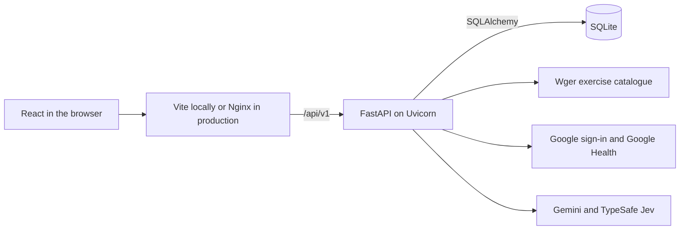

# Jern backend

The backend serves Jern's workout tracker, training calendar, progress dashboard,
AI Coach, and Google Health integration. It runs on Python 3.12 in CI and Docker.
Uvicorn serves the FastAPI app, Pydantic validates request payloads, and
SQLAlchemy reads and writes the SQLite database.

## How it connects



1. The browser calls `/api/v1` on the same origin as the frontend by default.
   Locally, Vite forwards `/api` to `127.0.0.1:8000`. In production, Nginx
   serves the React build and forwards `/api` to the private backend. [Frontend API client](../src/shared/api/client.ts) · [Vite config](../vite.config.ts) · [Nginx config](../nginx.conf)
2. During Google sign-in, the browser sends the Google ID token to
   `GET /api/v1/session`. The backend verifies the token and email allowlist,
   then issues an HttpOnly cookie backed by a revocable database session.
   Subsequent requests use the cookie, and logout revokes the session.
3. FastAPI passes the authenticated account to a request-scoped SQLAlchemy
   session. Account-owned reads are scoped to that account, and new
   account-owned records are stamped with its owner. The API normally returns
   JSON. Coach turns return Server-Sent Events (SSE) for progress and replies. [Coach streaming client](../src/features/coach/api.ts)

## Where the code lives

| Path | Responsibility |
| --- | --- |
| [`app/main.py`](app/main.py) | App entry point, authentication middleware, request schemas, SQLAlchemy models, and the core tracker and Coach API routes. Registers the Health and demo routers. |
| [`app/chatBot.py`](app/chatBot.py), [`app/prompt.py`](app/prompt.py), [`app/tools.py`](app/tools.py), [`app/topic_policy.py`](app/topic_policy.py) | Coach conversation context, Gemini requests, training tools, and independent output screening. |
| [`app/health.py`](app/health.py) | Google Health OAuth, encrypted provider tokens, and syncing and normalizing health data. |
| [`app/demo.py`](app/demo.py) | Optional read-only public views of a configured account's training data. |
| [`app/database_security.py`](app/database_security.py) | SQLite triggers that enforce ownership of routine-to-folder relationships. |
| [`alembic/versions/`](alembic/versions/) | Ordered database schema migrations. |
| [`tests/`](tests/) | API, database, Coach, Google Health, and demo verification. |

## How data moves through the app

- **Training and progress.** Routines are reusable templates organized into
  folders. Starting a routine copies its exercises and target sets into a
  workout draft, using the calendar's saved override for that day when one
  exists. Workout saves check the draft or session revision. A stale client
  gets a `409 Conflict` and must reload before saving. The calendar combines
  planned and logged workouts, and the dashboard derives training metrics
  from completed sessions alongside separately logged bodyweight entries.
- **Exercise search.** A background task refreshes the shared Wger catalogue
  in SQLite. Search reads the local catalogue, so cached results stay available
  during a Wger outage.
- **Coach.** The API stores the user's message and starts a Gemini turn with
  account-scoped training context. TypeSafe Jev checks generated replies and
  tool calls before release or execution. Plan changes become proposals that
  the user confirms before the backend applies them. The browser receives
  accepted replies and progress over SSE. [Coach topic policy](../docs/coach-topic-policy.md)
- **Google Health.** A separate OAuth flow grants read-only access. The backend
  stores encrypted provider tokens, fetches and normalizes readings, and
  caches a summary per account for the Health page. [Google Health setup](../docs/google-health.md)

## Run locally

From the repository root in PowerShell, create a Python virtual environment and
start the API. The development dependencies resolve for the current platform.

```powershell
cd backend
python -m venv .venv
.\.venv\Scripts\python.exe -m pip install -r requirements-dev.in
$env:APP_ENV = 'development'
$env:ENABLE_API_DOCS = 'true'
.\.venv\Scripts\python.exe -m uvicorn app.main:app --reload
```

Browse and try API routes in Swagger UI. [Local API docs](http://127.0.0.1:8000/docs)

Check the server from a separate terminal.

```powershell
Invoke-RestMethod http://127.0.0.1:8000/api/v1/health
```

To run the full app, use `npm ci` and `npm run dev` in a separate terminal at
the repository root, then open `http://localhost:5173`. Loopback requests in
development use the separate `local@workout.local` workspace without Google
sign-in.

With `DATABASE_URL` unset, the app creates `backend/workout_tracker.db` on
startup. The backend loads the repository-root `.env` when present, and process
environment variables take precedence. The core local tracker runs without
provider credentials. The example file lists the settings for Google sign-in,
Coach, Google Health, and the demo. [Environment settings](../.env.example)

## Test, build, and deploy

Run the backend suite from `backend/` in the environment installed above.

```powershell
.\.venv\Scripts\python.exe -m pytest -q
```

CI on Linux installs the hash-pinned `requirements-dev.lock`, runs pytest and
dependency audits, applies Alembic migrations to a test database, and checks
both containers. [CI workflow](../.github/workflows/security.yml)

To build the backend image from the repository root, run
`docker build -t jern-backend ./backend`. The image uses a Python 3.12 slim base
and installs the hash-pinned `requirements.lock`. At startup it runs
`alembic upgrade head` and then starts a single Uvicorn worker on port `8000`.
The `uvicorn` command in the local quick start uses FastAPI's development
startup to initialize the database. [Backend Dockerfile](Dockerfile)

Docker Compose and the Render Blueprint both mount persistent storage at
`/data` for `workout_tracker.db`. Nginx exposes `/healthz` as a proxy to the
backend's `/api/v1/health` endpoint. [Docker Compose](../compose.yaml) · [Render deployment guide](../docs/render-deployment.md)
